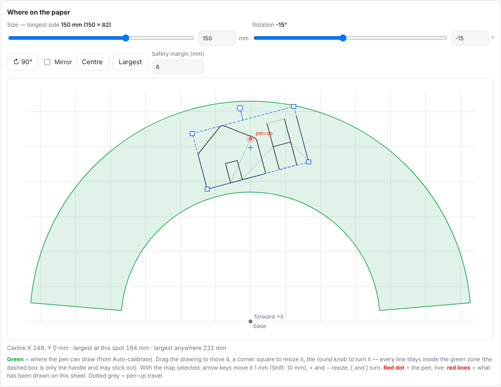
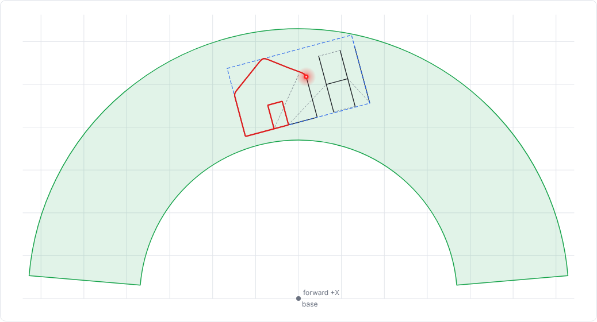
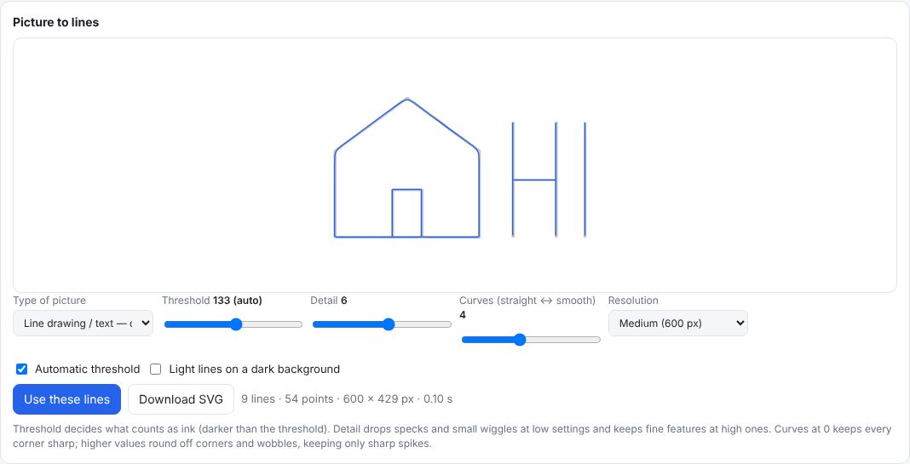
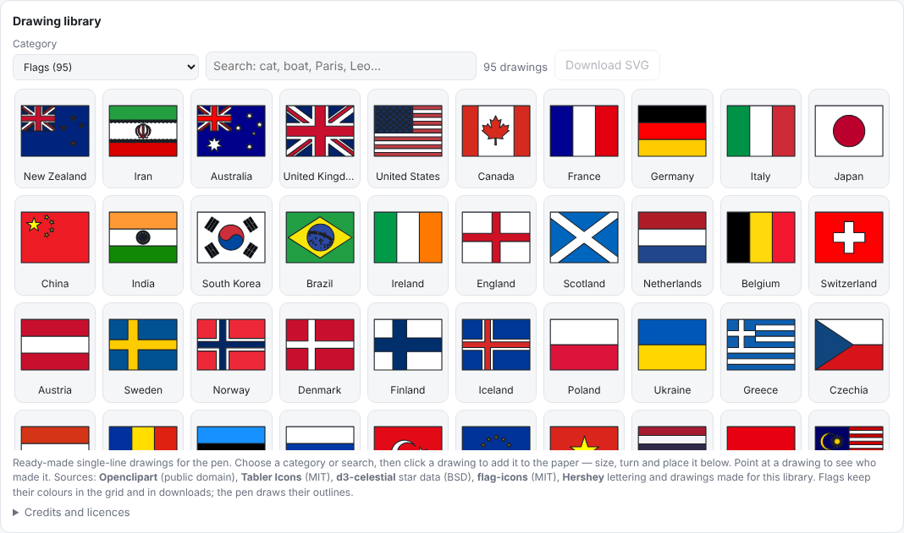
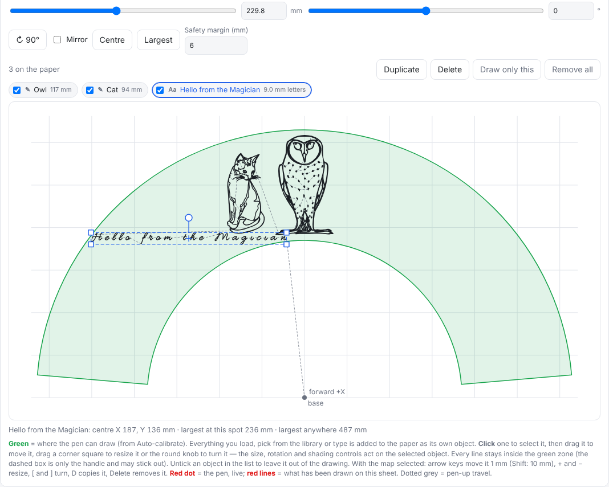
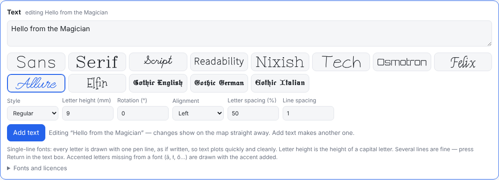
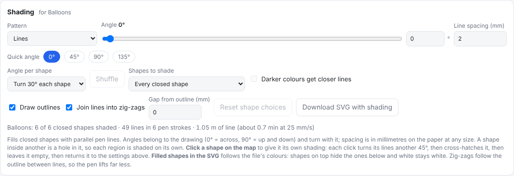
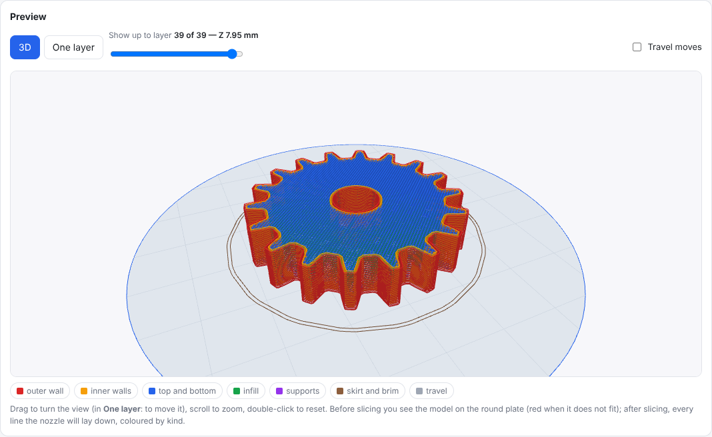
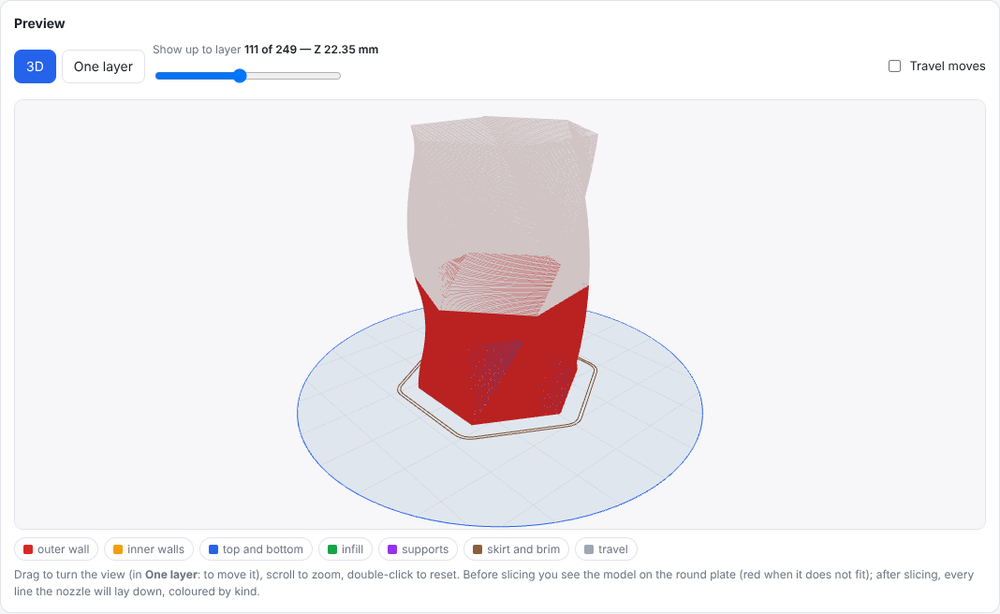

# Dobot Magician Controller

Control a **Dobot Magician** robot arm straight from your browser over USB — no Dobot software needed. Open one HTML file in Chrome or Edge, plug the arm in, and draw, write, 3D print, move, record, dance and react.

**Use it online:** [open the app](https://kalatehjari.github.io/dobot-magician-controller/app/) · [website](https://kalatehjari.github.io/dobot-magician-controller/) — nothing to download. Or get the single HTML file from the [latest release](../../releases/latest).



## Features

- **Plotter**
  - Draws **SVG** files, or turns **pictures** (PNG, JPG, WEBP, GIF, BMP) into lines: outlines for shapes, single centre lines for line art and text, or edges for photos. Threshold, detail and curve smoothing are adjustable, and the lines can be downloaded as SVG.
  - **Free placement:** set the size in millimetres, turn the drawing to any angle, mirror it, and drag, resize or rotate it on the map. The **green zone** shows where the pen can reach at drawing height, and every line is kept inside it.
  - **Optimised path:** strokes are ordered to cut pen-up travel (nearest neighbour + 2-opt), joined where they touch and simplified. Pen-up hops that would cross the unreachable area near the base go around it.
  - **Drawing library:** 2 245 ready-made single-line drawings in 31 categories — animals, cars and sports cars, male and female poses, faces, flags (in colour), city skylines, songs as sheet music, constellations, zodiac, leaves, topography, aircraft, army, ants, sci-fi, clothing, shoes, signs, emojis, objects, technology, phones and electronics, music, art and more. Choose a category or search, click a drawing to add it to the paper, or download it as SVG. The same drawings come as a folder of SVG files with the release.
  - **Several objects on one sheet:** drawings, pictures and text each keep their own size, place, turn and shading. Copy, delete, choose which ones to draw, save and open layouts, and export the whole sheet as one SVG.
  - **Text:** 13 single-line fonts (Hershey and EMS) in up to four styles; letter height in millimetres, rotation, alignment, spacing, several lines and accented letters.
  - **Shading:** hatch lines inside closed shapes — lines, cross-hatch or three directions, at any angle and spacing in millimetres, a different angle per shape, closer lines for darker colours, and zig-zag joining so the pen lifts less. Click a shape on the map to give it its own shading.
  - **Hover round:** before drawing, the pen goes once round the outside of everything (a box or the outline) just above the paper, so you can check the paper is in the right place.
  - **Quiet, smooth motion:** the whole drawing runs as one continuous path with low, rounded pen hops instead of stopping at every lift. Choose Quiet & smooth, Balanced or Fast; a quiet-speed finder listens with the microphone and picks the quietest speeds. A precise stop-at-every-point mode, pause and resume, and a 20 mm test square are there too.
  - **Live view:** the pen shows as a red laser dot, and finished lines turn red as the arm draws them.
- **3D printing** (with Dobot's 3D-printing kit and 3D-printer firmware)
  - Load **STL** (binary or ASCII) or **OBJ** files, or one of seven built-in models. Choose the file's units; scale, turn, tip over, lay flat on the largest face, mirror, move, or fit to the plate. A model that does not fit the plate is shown in red.
  - **Built-in slicer:** walls, solid top and bottom, lines or grid infill, supports (only from the plate, or everywhere), skirt and brim, retraction only when the nozzle leaves the part, vase mode (one spiral wall), and slower layers for small parts. Overlapping bodies in one file merge. Defaults follow Dobot's guide: 0.2 mm layers with a 0.35 mm first layer, 200 °C with the fan on, walls at 4 mm/s and infill at 8 mm/s, 6 mm retraction at 60 mm/s, a Ø80 mm plate centred at X0 Y0 and up to 150 mm high. Every setting, and the start and end G-code, can be changed.
  - **Preview** of the model on the plate and of every line the nozzle will lay down, coloured by kind, in 3D or one layer at a time.
  - **Print** straight from the page over USB — heat, feed filament, save the nozzle height (M415), fan — with line numbers, checksums and automatic resend, live progress, pause (the nozzle lifts and backs the filament off) and stop. Or download the G-code for Repetier Host or Cura. A printer simulator lets you try it all without hardware.
- **Mouse control** — click or drag on a map of the reach to move the arm; keyboard nudges; pen up/down, suction cup and gripper.
- **Record & learn** — record movements, average several takes into one smooth learned movement, and replay it.
- **Dance** — finds the beat in a song file, from the microphone or a metronome, and dances to it.
- **Imitate** — the arm mirrors your hand or arm through the webcam (following glides smoothly instead of jumping); draw in the air with a pinch; teach a movement by showing it.
- **Face & reactions** — reads expressions, winks, nods, head shakes and hand signs, reacts to them, and can follow your face.
- **Auto-calibration** — centres the arm, checks its joint readings against the Magician's geometry, measures the tool offset and works out the reachable area at every height. The only manual step is lowering the pen onto the paper.
- **Safety** — every target is kept inside the reachable space, alarms are shown and can be cleared, and **STOP** (or Esc) halts everything.
- **Simulator** — try every feature without hardware.

| Live drawing | Picture to lines |
| --- | --- |
|  |  |
| **Drawing library** | **Several objects and text** |
|  |  |
| **Text tool** | **Shading** |
|  |  |
| **3D print preview** | **Printing (simulator)** |
|  |  |

## Quick start

1. Open the [app online](https://kalatehjari.github.io/dobot-magician-controller/app/), or download `magician-smart-controller.html` from the [latest release](../../releases/latest) (or from this repository) and open it.
2. Use **Google Chrome** or **Microsoft Edge** on a desktop computer. Safari and Firefox do not support Web Serial. (The online app and a downloaded file keep their calibration and settings separately.)
3. Switch the Magician on and plug it in with USB. Click **Connect USB** and pick the arm's serial port.
4. The calibration dialog opens. Click **Start auto-calibration**, lower the pen onto the paper with the ▼ buttons, then click **This is the paper**.
5. Open **Plotter**, pick a drawing from the library, drop in an SVG or a picture, or type some text. Place it in the green zone, press **Hover round** to check the paper, and click **Draw**.

No arm at hand? Click **Simulator** instead of Connect USB.

### 3D printing

1. Fit the 3D-printing kit as in Dobot's guide: hot end on the forearm, heater cable on interface 4, fan on 5, temperature sensor on 6, extruder motor on Stepper1; filament through the extruder and the PTFE tube down to the hot end.
2. Put Dobot's 3D-printer firmware on the arm: in DobotStudio choose **Tools → Open 3D Printing** and confirm. Then close DobotStudio and Repetier Host, so the page can use the USB port.
3. Open the **3D print** tab and click **Connect 3D printer (USB)**. Press **Heat**, wait for 200 °C, and **Feed 10 mm** until plastic comes out.
4. Stick masking tape on the plate. Hold the forearm's unlock button and lower the nozzle until it just touches the tape, then press the **Key** button on the base (or **Save nozzle height** in the page). The arm beeps.
5. Load a model, place it, press **Slice**, check the preview, and press **Start print…**.

To use the other tabs again, the arm needs DobotStudio's normal firmware: DobotStudio offers to switch back when you next connect with it. No printer? **Printer simulator** runs everything without hardware.

If the arm does not appear in the port list, check the cable and that the arm is switched on; some computers also need a driver for the arm's USB-serial chip.

## Requirements

- A desktop browser with Web Serial: Chrome or Edge.
- For the camera features: a webcam and an internet connection the first time, to download the vision models (Google MediaPipe). Camera images are processed in the browser and are not uploaded.

## Safety

- Keep hands and objects clear of the arm. In the Dance, Imitate and Face tabs the arm moves by itself.
- **STOP** (or Esc) halts motion and clears the arm's command queue. If the arm's red light comes on, use the red bar to clear the alarm.
- The software limits help but are not a substitute for watching the arm.
- When 3D printing, the nozzle reaches 200 °C or more: don't touch it, and stay with the printer. **Stop print** turns the heater off and lifts the nozzle; the red **STOP** halts the printer at once (M112 and a reset).

## How it works

- **USB:** the page talks to the arm through the browser's Web Serial API at 115 200 baud, using the Magician's binary protocol: frames `AA AA len id ctrl params checksum`, commands queued in the arm's 32-slot buffer and paced by its queue index.
- **Commands used:** 10 pose · 20 alarms · 31 home · 80/81/83 speed · 84 point-to-point move · 90/91 continuous path · 62/63 suction and gripper · 240/241/245/246 queue start, pause, clear and index.
- **Geometry:** rear arm 135 mm, forearm 147 mm, with the Magician's joint limits. Auto-calibration confirms the joint conventions on your arm (two poses must agree within 2 mm) and measures the tool offset; the reachable area at each height follows from that.
- **Placement:** a drawing is placed by centre, size, angle and mirror. A fast check (convex hull for the outer edge and side limits, short line chunks for the inner edge) keeps it inside the zone while you drag, and finds the largest size that fits — one that also fits at every smaller size.
- **Smooth motion:** strokes are cut into short continuous-path moves and short gaps become rounded hops, so the arm's controller can look ahead instead of stopping; speed and acceleration are capped for every command.
- **Drawing library:** each drawing is stored on a 0–1000 grid as base-64 delta runs (about 3 MB for all 2 245). Sources: [Openclipart](https://openclipart.org) (public domain), [Tabler Icons](https://tabler.io/icons) (MIT), [d3-celestial](https://github.com/ofrohn/d3-celestial) star data (BSD 3-Clause), [flag-icons](https://github.com/lipis/flag-icons) (MIT), Hershey lettering, and drawings made by program for this project (`tools/library`). The app shows the credits and licence texts (Plotter → Drawing library → Credits and licences).
- **Text:** single-line Hershey and EMS fonts, encoded compactly (`tools/fonts`).
- **3D printing:** the model is cut through the middle of every layer; each mesh edge that crosses the cut gives one point, so neighbouring triangles link into closed outlines exactly. Walls, skins and supports are offsets and boolean operations on those outlines with [Clipper](http://www.angusj.com) (integer micrometres); infill is scan lines on a fixed grid, joined into zig-zags where the link stays inside the part. Solid layers go wherever the part is open above or below within the top and bottom layer counts. The G-code is Marlin-style (absolute positions, extrusion reset each layer) for Dobot's 3D-printer firmware, centred on X0 Y0 as in Dobot's Cura profile. The page sends it over Web Serial at 115 200 baud with line numbers and checksums, one line per `ok` by default (or ahead into the 63-byte buffer, as Repetier Host does), resending damaged lines and renumbering after a printer restart.
- **One file:** the app is a single self-contained HTML page built from the files in `src/`.

## Project layout

```
magician-smart-controller.html   the app (built; open this file)
build.py                         joins src/ into the app (and its website copy, docs/app/index.html)
src/                             source, one file per feature (build order in build.py)
tests/unit/                      Node.js tests, no dependencies
tests/e2e/                       browser tests (Playwright + the built-in simulator)
tools/library/                   how the drawing library was made (generators, export)
tools/fonts/                     how the single-line fonts were made
docs/                            the website (GitHub Pages): landing page, the app in docs/app/, screenshots
```

The website is served by GitHub Pages from `docs/` on `main`: `index.html` (the landing page), `app/index.html` (the app, written by `build.py`), `sitemap.xml`, `404.html`, the social card and icons, and an IndexNow key file. `tests/unit/test_site.js` checks that the app copy matches and that every link, picture and search-engine tag is in place.

## Building and testing

```sh
python3 build.py                     # rebuilds magician-smart-controller.html (and docs/app/index.html) from src/
node tests/unit/run_all.js           # unit tests (or: npm test)

pip install playwright && playwright install chromium
python3 tests/e2e/e2e_drawing.py     # calibration, tracing, smooth drawing, pause
python3 tests/e2e/e2e_placement.py   # placement, dragging, live pen and red lines
python3 tests/e2e/e2e_smooth.py      # motion profiles, continuous drawing, glide following
python3 tests/e2e/e2e_shade.py       # shading
python3 tests/e2e/e2e_objects.py     # several objects, text tool, layouts
python3 tests/e2e/e2e_library.py     # drawing library: every drawing loads and fits
python3 tests/e2e/e2e_print.py       # 3D printing: files, placement, slicing, printing on the simulator
```

`e2e_library.py` also compares the library folder with the app when the folder from the release is unpacked as `plotter-library/` at the repository root (or `MAGICIAN_LIBRARY` points at it).

The app also has a built-in self-test: **Setup → Test camera features**, or open the file with `?selftest=1`. It loads the vision models, checks the camera, the beat tracker, the picture tracer, the geometry model, placement, smooth motion, the drawing library, shading, text, several objects and 3D printing (a model sliced and printed on the printer simulator), all with the simulators so nothing moves or heats.

## Status

Version 1.5.0 (see the [changelog](CHANGELOG.md)). The app is tested with the built-in kinematic simulator and printer simulator (unit and browser tests) and with the self-test in Chrome on macOS. Testing on a physical arm is limited so far; auto-calibration checks the arm's joint conventions live and stops if they do not match. 3D printing follows the settings in Dobot's guide and has not yet been tried on a physical 3D-printing kit, so watch the first prints closely. If something does not work with your arm, please open an issue.

## Acknowledgements

- Protocol details were cross-checked against the open-source `pydobot` library and Dobot's `DobotDllType.py`.
- Vision uses [Google MediaPipe](https://github.com/google-ai-edge/mediapipe) Tasks Vision (Apache-2.0), loaded at runtime.
- Drawing library: the Openclipart artists (credited in the app and in the library's `CREDITS.md`), Tabler Icons by Paweł Kuna, d3-celestial by Olaf Frohn, and the flag-icons contributors.
- Fonts: the Hershey fonts by Dr. A. V. Hershey (U.S. National Bureau of Standards), the EMS fonts by Sheldon B. Michaels (SIL Open Font License 1.1), and their SVG versions by Windell H. Oskay (Evil Mad Scientist, `hersheytext`).
- 3D printing: [Clipper](http://www.angusj.com) by Angus Johnson (polygon clipping and offsetting) in Timo's JavaScript translation, which uses Tom Wu's JSBN; print defaults from Dobot's Magician user guide and Dobot's printing tips.

## Licence

[MIT](LICENSE), except `src/part48_clipper.js`: Clipper 6.4.2 (Boost Software License 1.0) with JSBN (Tom Wu's licence). Both licence texts are in that file and in the app (3D print → Print settings → Credits and licences).

This project is not affiliated with or endorsed by Dobot. "Dobot" and "Magician" are trademarks of their respective owner.
